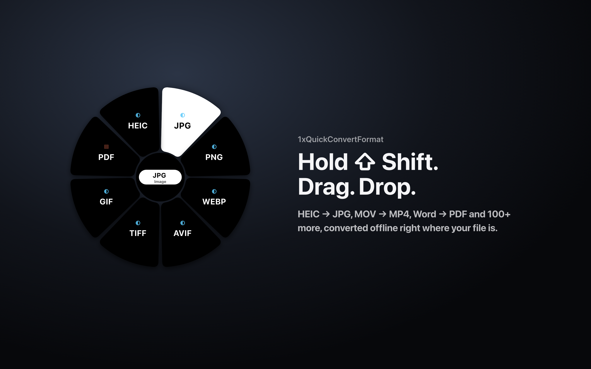

  

<h1 align="center">1xQuickConvertFormat</h1>

  <strong>Offline file converter for macOS: hold Shift, drag a file in Finder, drop it on a format.</strong> 
  HEIC to JPG, MOV to MP4, Word to PDF, Excel to CSV, TCVN3/VNI to Unicode and 100+ more conversions, without uploading anything.

  <a href="https://1x.xuanhieu.org/qcf/en"><strong>Website</strong></a> ·
  <a href="https://1x.xuanhieu.org/qcf/free?lang=en">Get a free code</a> ·
  <a href="https://1x.xuanhieu.org/qcf/buy?lang=en">Buy Personal</a> ·
  <a href="README.vi.md">Tiếng Việt</a>

**1xQuickConvertFormat** is a macOS menu-bar app made by [Phạm Xuân Hiếu](https://xuanhieu.org/gioi-thieu) (Xuan Hieu) that converts images, video, audio, Office documents, PDF, data files and source code directly on your Mac. You hold <kbd>Shift</kbd> while dragging a file in Finder, a format wheel appears under the cursor, and you drop the file on the format you want. The converted file is saved next to the original. Nothing is uploaded to a server.

> **Status:** pre-release. The first build signed with an Apple Developer ID and notarized by Apple will be published under [Releases](https://github.com/xuanhieu/1xQuickConvertFormat/releases). Watch this repository or follow the [website](https://1x.xuanhieu.org/qcf/en) to be notified.

## At a glance

| | |
|---|---|
| Developer | [Phạm Xuân Hiếu](https://xuanhieu.org/gioi-thieu) · [xuanhieu.org](https://xuanhieu.org) |
| Platform | macOS 12.3 or later, Apple Silicon and Intel (universal app) |
| Interface | Vietnamese and English |
| Where it runs | Menu bar; conversions are done locally on the Mac |
| Price | Free plan by invite code; Personal from 199.000đ / US$8.99 per year or 479.000đ / US$19.99 once |
| Website | [1x.xuanhieu.org/qcf](https://1x.xuanhieu.org/qcf/en) |
| License | Proprietary, see [EULA](EULA.md) |

## How it works

1. Hold <kbd>Shift</kbd> and start dragging one or more files in Finder.
2. A wheel appears under the cursor with only the formats those files can become. Formats that need an engine you have not installed are dimmed, with the reason.
3. Drop the files on a format. The results appear next to the originals, with a numbered name if a file with that name already exists.

## Why use it

- **One gesture, no windows.** No app to open, no upload page, no export dialog.
- **Private by design.** Every conversion runs on your Mac. The app has no analytics, tracking or ads. See the [Privacy Policy](PRIVACY.md).
- **Real documents, not only images.** Word, Excel, PowerPoint (including the 97–2003 formats), PDF, video, audio, data and source code.
- **Vietnamese text done right.** Input encodings are detected automatically, old TCVN3 and VNI documents can be converted to Unicode, and CSV files are written so Excel shows Vietnamese accents correctly.
- **Stays out of the way.** Lives in the menu bar, can open at login, and never interrupts an ordinary drag because the wheel only appears while Shift is held.

## What it converts

| Group | From | To |
|---|---|---|
| Images | PNG, JPG, WEBP, AVIF, HEIC/HEIF, TIFF, BMP, GIF, ICO, SVG | PNG, JPG, WEBP, AVIF, TIFF, BMP, GIF, ICO, PDF (from SVG) |
| Video | MP4, MOV, MKV, AVI, WEBM, WMV, FLV, 3GP, TS | MP4, MOV, MKV, AVI, WEBM, WMV, FLV, 3GP, TS, GIF |
| Audio | MP3, WAV, FLAC, AAC, M4A, OGG, OPUS, AIFF, WMA | the same, plus audio extracted from video |
| Documents | DOC, DOCX, RTF, ODT, Pages, WPS, WordPerfect, EPUB, MHT, webarchive and more | PDF, DOCX, DOC, ODT, RTF, TXT, HTML, Markdown, EPUB |
| Spreadsheets | XLS, XLSX, XLSB, ODS, Numbers, CSV, TSV, DBF, Lotus 1-2-3 and more | PDF, XLSX, XLS, ODS, CSV, TSV, JSON, HTML |
| Presentations | PPT, PPTX, PPS, ODP, Keynote and more | PDF, PPTX, PPT, ODP |
| Text and code | TXT, Markdown, HTML, JS, TS, CSS, Python, SQL, PHP, Java, Go, Rust, C/C++, C#, Swift and more | syntax-highlighted HTML, PDF, TXT, Markdown |
| Data | JSON, YAML, TOML, XML, CSV, TSV | JSON, YAML, TOML, XML, CSV, TSV |
| PDF | PDF | PNG, JPG, TXT |
| Vietnamese legacy fonts | TCVN3 (.VnTime, ABC) and VNI text in TXT, CSV, HTML, DOC, DOCX, XLS, XLSX and more | Unicode, keeping the original format |

Video and audio use [FFmpeg](https://ffmpeg.org) (`brew install ffmpeg`); layout-faithful Office conversions use [LibreOffice](https://www.libreoffice.org/download/). Both are free, installed separately and detected automatically.

## Step-by-step guides

- [How to convert HEIC to JPG on a Mac](https://1x.xuanhieu.org/qcf/convert-heic-to-jpg-on-mac) ([Tiếng Việt](https://1x.xuanhieu.org/qcf/chuyen-heic-sang-jpg-tren-mac))
- [Chuyển MOV sang MP4 trên Mac](https://1x.xuanhieu.org/qcf/chuyen-mov-sang-mp4-tren-mac) (Vietnamese)
- [Chuyển Word sang PDF trên Mac](https://1x.xuanhieu.org/qcf/chuyen-word-sang-pdf-tren-mac) (Vietnamese)
- [Chuyển font TCVN3, VNI sang Unicode trên Mac](https://1x.xuanhieu.org/qcf/chuyen-font-tcvn3-vni-sang-unicode-tren-mac) (Vietnamese)

## Plans

Every plan is for **one Mac**.

| | Free | Personal · 1 year | Personal · Lifetime |
|---|---|---|---|
| Price | free | 199.000đ or US$8.99 / year | 479.000đ or US$19.99 once |
| How to get it | an invite code from a friend, or [get one here](https://1x.xuanhieu.org/qcf/free?lang=en) | [buy online](https://1x.xuanhieu.org/qcf/buy?lang=en) | [buy online](https://1x.xuanhieu.org/qcf/buy?lang=en) |
| Images, text, data and code | Yes | Yes | Yes |
| Video, audio, Office and PDF | | Yes | Yes |
| Many files at once | | Yes | Yes |
| Quality, size, output folder and codec options | | Yes | Yes |
| Move to a new Mac | | up to 3 times a year | up to 3 times a year |

New installs include a **7-day trial** of the Free features. Every activated Mac gets 3 invite codes to share. Pay by Vietnamese bank transfer (VietQR, also scannable with MoMo or ZaloPay). The license key appears on screen and by email as soon as the payment arrives. Because of the free trial, purchases are not refundable (see [EULA §8](EULA.md#8-refunds)).

## Install

1. Download the `.dmg` from [Releases](https://github.com/xuanhieu/1xQuickConvertFormat/releases) once the first release is published, and check its SHA-256 against `SHA256SUMS.txt` if you like.
2. Open it and drag **1xQuickConvertFormat** into **Applications**.
3. Open the app, choose your language, then start the trial or enter your code in **Settings › License**.
4. Hold <kbd>Shift</kbd> while dragging a file in Finder.

To uninstall, quit the app from the menu bar and move it to the Trash.

## FAQ

**How do I convert HEIC photos to JPG on a Mac?**
Hold Shift, drag the HEIC photos in Finder and drop them on JPG. The JPG files appear next to the originals, keeping the photo's colour profile and orientation. Step by step: [HEIC to JPG on Mac](https://1x.xuanhieu.org/qcf/convert-heic-to-jpg-on-mac).

**How do I convert old Vietnamese documents typed in TCVN3 or VNI to Unicode?**
Drop the file on **Unicode**. The app finds text set in .VnTime, .VnArial, VNI-Times and similar fonts, converts it to Unicode and switches the font to Times New Roman, keeping the original format (DOCX stays DOCX, XLS stays XLS).

**Are my files uploaded anywhere?**
No. Conversions run on your Mac. The app only goes online to activate and re-check your license about once a week, and keeps working offline for 30 days between checks.

**Where do converted files go?**
Next to the original, with a numbered name if needed. Personal can choose another output folder.

**Why do I have to hold Shift?**
So ordinary drags in Finder are never interrupted. The wheel only appears while Shift is held.

**Does it work on Intel Macs?**
Yes. The app is universal (Apple Silicon and Intel) and needs macOS 12.3 or later.

**Do I need FFmpeg or LibreOffice?**
Only for video/audio (FFmpeg) and for layout-faithful Office conversions (LibreOffice). Images, text, data, code and basic Word conversions work without them.

**Can I move my license to a new Mac?**
Yes. Use **Settings › License › Deactivate** on the old Mac, then enter the key on the new one (up to 3 times in 12 months).

## About the author

1xQuickConvertFormat is designed and maintained by **Phạm Xuân Hiếu** (Xuân Hiếu, Pham Xuan Hieu), an AI-native Growth Systems Builder who has been active on the web since 2012 and has run [xuanhieu.org](https://xuanhieu.org) since 2014. He builds tools, automations and guides that are meant to be run, measured and handed over.

- Website: [xuanhieu.org](https://xuanhieu.org)
- About: [xuanhieu.org/gioi-thieu](https://xuanhieu.org/gioi-thieu)
- GitHub: [@xuanhieu](https://github.com/xuanhieu)
- Email: mail@xuanhieu.org

## Support

Bugs and feature requests: [open an issue](https://github.com/xuanhieu/1xQuickConvertFormat/issues/new/choose). License and payment questions: mail@xuanhieu.org. Security reports: see [SECURITY.md](SECURITY.md).

## License

1xQuickConvertFormat is proprietary software. Copyright © 2026 Phạm Xuân Hiếu. All rights reserved. Use is governed by the [EULA](EULA.md) ([Tiếng Việt](EULA.vi.md)) and the [Privacy Policy](PRIVACY.md). This repository holds documentation and release downloads only; it contains no source code and grants no right to copy or modify the software. To cite the project, use the **Cite this repository** button (see [CITATION.cff](CITATION.cff)).

The app builds on open-source components, including [Vertex](https://github.com/rainaku/Vertex) by rainaku (Apache License 2.0), [Tauri](https://tauri.app) and [Svelte](https://svelte.dev). Their notices are listed in the app under **About › Acknowledgements**.

---

Made in Vietnam by [Phạm Xuân Hiếu](https://xuanhieu.org/gioi-thieu) · [xuanhieu.org](https://xuanhieu.org)
