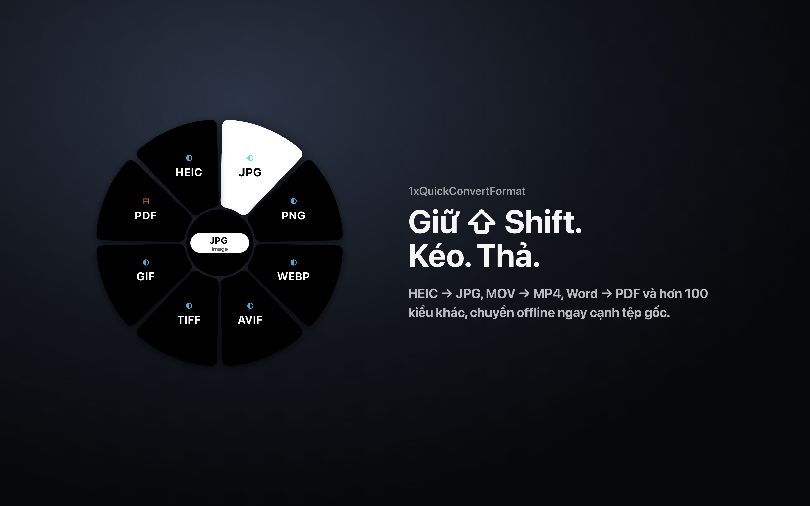

  

<h1 align="center">1xQuickConvertFormat</h1>

  <strong>Ứng dụng chuyển đổi định dạng tệp ngay trên máy Mac: giữ Shift, kéo tệp trong Finder, thả vào định dạng muốn đổi.</strong> 
  HEIC sang JPG, MOV sang MP4, Word sang PDF, Excel sang CSV, TCVN3/VNI sang Unicode và hơn 100 kiểu chuyển đổi khác, không cần tải tệp lên mạng.

  <a href="https://1x.xuanhieu.org/qcf"><strong>Trang chủ</strong></a> ·
  <a href="https://1x.xuanhieu.org/qcf/free">Nhận mã miễn phí</a> ·
  <a href="https://1x.xuanhieu.org/qcf/buy">Mua bản Personal</a> ·
  <a href="README.md">English</a>

**1xQuickConvertFormat** là ứng dụng thanh menu cho macOS do [Phạm Xuân Hiếu](https://xuanhieu.org/gioi-thieu) (Xuân Hiếu) phát triển, dùng để chuyển đổi ảnh, video, âm thanh, tài liệu Office, PDF, tệp dữ liệu và mã nguồn ngay trên máy Mac. Bạn giữ <kbd>Shift</kbd> trong khi kéo tệp trong Finder, một vòng định dạng hiện ra dưới con trỏ, rồi thả tệp vào định dạng muốn đổi. Tệp kết quả được lưu ngay cạnh tệp gốc. Không có tệp nào bị tải lên máy chủ.

> **Trạng thái:** sắp phát hành. Bản đầu tiên được ký bằng Apple Developer ID và notarize bởi Apple sẽ được đăng ở mục [Releases](https://github.com/xuanhieu/1xQuickConvertFormat/releases). Bấm Watch repo này hoặc theo dõi [trang chủ](https://1x.xuanhieu.org/qcf) để nhận thông báo.

## Thông tin nhanh

| | |
|---|---|
| Nhà phát triển | [Phạm Xuân Hiếu](https://xuanhieu.org/gioi-thieu) · [xuanhieu.org](https://xuanhieu.org) |
| Nền tảng | macOS 12.3 trở lên, chip Apple Silicon và Intel (ứng dụng universal) |
| Giao diện | Tiếng Việt và tiếng Anh |
| Cách hoạt động | Nằm trên thanh menu; mọi chuyển đổi diễn ra ngay trên máy Mac |
| Giá | Bản Free dùng mã mời; Personal từ 199.000đ/năm hoặc 479.000đ mua một lần |
| Trang chủ | [1x.xuanhieu.org/qcf](https://1x.xuanhieu.org/qcf) |
| Giấy phép | Phần mềm độc quyền, xem [EULA](EULA.vi.md) |

## Cách dùng

1. Giữ <kbd>Shift</kbd> rồi bắt đầu kéo một hoặc nhiều tệp trong Finder.
2. Vòng định dạng hiện ra dưới con trỏ, chỉ gồm những định dạng các tệp đó đổi được. Định dạng cần công cụ bạn chưa cài sẽ hiện mờ kèm lý do.
3. Thả tệp vào một định dạng. Kết quả nằm cạnh tệp gốc, tự đánh số nếu trùng tên.

## Vì sao nên dùng

- **Một thao tác, không cửa sổ.** Không cần mở app, không cần trang tải lên, không có hộp thoại xuất tệp.
- **Riêng tư từ thiết kế.** Mọi chuyển đổi chạy trên máy Mac của bạn. Ứng dụng không có công cụ thống kê, theo dõi hay quảng cáo. Xem [Chính sách quyền riêng tư](PRIVACY.md).
- **Làm được tài liệu thật, không chỉ ảnh.** Word, Excel, PowerPoint (kể cả định dạng 97–2003), PDF, video, âm thanh, dữ liệu và mã nguồn.
- **Xử lý đúng tiếng Việt.** Tự nhận dạng bảng mã đầu vào, đổi tài liệu cũ gõ bằng font TCVN3 và VNI sang Unicode, và ghi tệp CSV theo cách Excel hiển thị đủ dấu.
- **Không làm phiền.** Nằm trên thanh menu, có thể tự mở khi đăng nhập, và không bao giờ cản thao tác kéo thả bình thường vì vòng định dạng chỉ hiện khi bạn giữ Shift.

## Đổi được những gì

| Nhóm | Từ | Sang |
|---|---|---|
| Ảnh | PNG, JPG, WEBP, AVIF, HEIC/HEIF, TIFF, BMP, GIF, ICO, SVG | PNG, JPG, WEBP, AVIF, TIFF, BMP, GIF, ICO, PDF (từ SVG) |
| Video | MP4, MOV, MKV, AVI, WEBM, WMV, FLV, 3GP, TS | MP4, MOV, MKV, AVI, WEBM, WMV, FLV, 3GP, TS, GIF |
| Âm thanh | MP3, WAV, FLAC, AAC, M4A, OGG, OPUS, AIFF, WMA | như bên trái, và tách tiếng từ video |
| Văn bản | DOC, DOCX, RTF, ODT, Pages, WPS, WordPerfect, EPUB, MHT, webarchive và nhiều định dạng khác | PDF, DOCX, DOC, ODT, RTF, TXT, HTML, Markdown, EPUB |
| Bảng tính | XLS, XLSX, XLSB, ODS, Numbers, CSV, TSV, DBF, Lotus 1-2-3 và nhiều định dạng khác | PDF, XLSX, XLS, ODS, CSV, TSV, JSON, HTML |
| Trình chiếu | PPT, PPTX, PPS, ODP, Keynote và nhiều định dạng khác | PDF, PPTX, PPT, ODP |
| Văn bản thuần và mã nguồn | TXT, Markdown, HTML, JS, TS, CSS, Python, SQL, PHP, Java, Go, Rust, C/C++, C#, Swift và nhiều ngôn ngữ khác | HTML tô màu cú pháp, PDF, TXT, Markdown |
| Dữ liệu | JSON, YAML, TOML, XML, CSV, TSV | JSON, YAML, TOML, XML, CSV, TSV |
| PDF | PDF | PNG, JPG, TXT |
| Font tiếng Việt cũ | Chữ TCVN3 (.VnTime, ABC) và VNI trong TXT, CSV, HTML, DOC, DOCX, XLS, XLSX và nhiều định dạng khác | Unicode, giữ nguyên định dạng tệp |

Video và âm thanh dùng [FFmpeg](https://ffmpeg.org) (`brew install ffmpeg`); chuyển đổi Office giữ đúng bố cục dùng [LibreOffice](https://www.libreoffice.org/download/). Cả hai đều miễn phí, cài riêng và được ứng dụng tự nhận ra.

## Hướng dẫn từng bước

- [Chuyển HEIC sang JPG trên Mac](https://1x.xuanhieu.org/qcf/chuyen-heic-sang-jpg-tren-mac)
- [Chuyển MOV sang MP4 trên Mac](https://1x.xuanhieu.org/qcf/chuyen-mov-sang-mp4-tren-mac)
- [Chuyển Word sang PDF trên Mac](https://1x.xuanhieu.org/qcf/chuyen-word-sang-pdf-tren-mac)
- [Chuyển font TCVN3, VNI sang Unicode trên Mac](https://1x.xuanhieu.org/qcf/chuyen-font-tcvn3-vni-sang-unicode-tren-mac)

## Các gói

Mỗi gói dùng cho **một máy Mac**.

| | Free | Personal · 1 năm | Personal · Trọn đời |
|---|---|---|---|
| Giá | miễn phí | 199.000đ/năm | 479.000đ, mua một lần |
| Cách nhận | mã mời từ bạn bè, hoặc [nhận mã tại đây](https://1x.xuanhieu.org/qcf/free) | [mua trực tuyến](https://1x.xuanhieu.org/qcf/buy) | [mua trực tuyến](https://1x.xuanhieu.org/qcf/buy) |
| Ảnh, văn bản thuần, dữ liệu và mã nguồn | Có | Có | Có |
| Video, âm thanh, Office và PDF | | Có | Có |
| Đổi nhiều tệp cùng lúc | | Có | Có |
| Tuỳ chọn chất lượng, kích thước, thư mục lưu và codec | | Có | Có |
| Chuyển sang máy Mac mới | | tối đa 3 lần/năm | tối đa 3 lần/năm |

Lần cài đầu có **7 ngày dùng thử** các tính năng của bản Free. Mỗi máy đã kích hoạt nhận 3 mã mời để chia sẻ. Thanh toán bằng chuyển khoản ngân hàng (VietQR, quét được bằng MoMo hoặc ZaloPay). License key hiện ngay trên màn hình và gửi qua email khi tiền về. Vì đã có dùng thử miễn phí nên không hoàn tiền sau khi mua (xem [EULA mục 8](EULA.vi.md)).

## Cài đặt

1. Tải tệp `.dmg` ở mục [Releases](https://github.com/xuanhieu/1xQuickConvertFormat/releases) khi bản đầu tiên được phát hành. Nếu muốn, đối chiếu mã SHA-256 với tệp `SHA256SUMS.txt`.
2. Mở tệp và kéo **1xQuickConvertFormat** vào thư mục **Applications**.
3. Mở ứng dụng, chọn ngôn ngữ, rồi bắt đầu dùng thử hoặc nhập mã ở **Cài đặt › Bản quyền**.
4. Giữ <kbd>Shift</kbd> khi kéo tệp trong Finder.

Muốn gỡ, thoát ứng dụng từ thanh menu rồi kéo nó vào Thùng rác.

## Câu hỏi thường gặp

**Làm sao đổi ảnh HEIC sang JPG trên Mac?**
Giữ Shift, kéo các ảnh HEIC trong Finder rồi thả vào JPG. Ảnh JPG nằm cạnh ảnh gốc, giữ nguyên hồ sơ màu và hướng xoay. Xem hướng dẫn: [Chuyển HEIC sang JPG trên Mac](https://1x.xuanhieu.org/qcf/chuyen-heic-sang-jpg-tren-mac).

**Làm sao đổi tài liệu cũ gõ bằng font TCVN3 hoặc VNI sang Unicode?**
Thả tệp vào **Unicode**. Ứng dụng tìm chữ dùng font .VnTime, .VnArial, VNI-Times và các font tương tự, đổi sang Unicode và chuyển font sang Times New Roman, giữ nguyên định dạng tệp (DOCX vẫn là DOCX, XLS vẫn là XLS). Xem hướng dẫn: [Chuyển font TCVN3, VNI sang Unicode trên Mac](https://1x.xuanhieu.org/qcf/chuyen-font-tcvn3-vni-sang-unicode-tren-mac).

**Tệp của tôi có bị tải lên đâu không?**
Không. Việc chuyển đổi chạy trên máy Mac của bạn. Ứng dụng chỉ kết nối mạng để kích hoạt và kiểm tra lại bản quyền khoảng một lần mỗi tuần, và vẫn chạy ngoại tuyến tối đa 30 ngày giữa hai lần kiểm tra.

**Tệp kết quả được lưu ở đâu?**
Cạnh tệp gốc, tự đánh số nếu trùng tên. Bản Personal chọn được thư mục lưu khác.

**Vì sao phải giữ Shift?**
Để thao tác kéo thả bình thường trong Finder không bao giờ bị gián đoạn. Vòng định dạng chỉ hiện khi bạn giữ Shift.

**Máy Mac chip Intel dùng được không?**
Được. Ứng dụng là bản universal (Apple Silicon và Intel), cần macOS 12.3 trở lên.

**Có cần cài FFmpeg hay LibreOffice không?**
Chỉ cần cho video, âm thanh (FFmpeg) và chuyển đổi Office giữ đúng bố cục (LibreOffice). Ảnh, văn bản thuần, dữ liệu, mã nguồn và chuyển đổi Word cơ bản chạy được mà không cần chúng.

**Chuyển bản quyền sang máy Mac mới được không?**
Được. Vào **Cài đặt › Bản quyền › Huỷ kích hoạt** trên máy cũ, rồi nhập key trên máy mới (tối đa 3 lần trong 12 tháng).

## Về tác giả

1xQuickConvertFormat do **Phạm Xuân Hiếu** (Xuân Hiếu, Pham Xuan Hieu) thiết kế và phát triển. Anh là một AI-native Growth Systems Builder, hoạt động trên web từ 2012 và vận hành [xuanhieu.org](https://xuanhieu.org) từ 2014. Anh xây dựng công cụ, hệ thống tự động hoá và hướng dẫn theo tiêu chí: vận hành được, đo được, chuyển giao được.

- Trang chủ: [xuanhieu.org](https://xuanhieu.org)
- Giới thiệu: [xuanhieu.org/gioi-thieu](https://xuanhieu.org/gioi-thieu)
- GitHub: [@xuanhieu](https://github.com/xuanhieu)
- Email: mail@xuanhieu.org

## Hỗ trợ

Báo lỗi và đề xuất tính năng: [mở issue](https://github.com/xuanhieu/1xQuickConvertFormat/issues/new/choose). Câu hỏi về bản quyền và thanh toán: mail@xuanhieu.org. Báo lỗ hổng bảo mật: xem [SECURITY.md](SECURITY.md).

## Giấy phép

1xQuickConvertFormat là phần mềm độc quyền. Copyright © 2026 Phạm Xuân Hiếu. All rights reserved. Việc sử dụng tuân theo [EULA](EULA.vi.md) ([English](EULA.md)) và [Chính sách quyền riêng tư](PRIVACY.md). Repo này chỉ chứa tài liệu và bản tải về, không có mã nguồn, và không cấp quyền sao chép hay sửa đổi phần mềm. Muốn trích dẫn dự án, dùng nút **Cite this repository** (xem [CITATION.cff](CITATION.cff)).

Ứng dụng được xây dựng trên các thành phần mã nguồn mở, gồm [Vertex](https://github.com/rainaku/Vertex) của rainaku (Apache License 2.0), [Tauri](https://tauri.app) và [Svelte](https://svelte.dev). Thông báo bản quyền của chúng có trong ứng dụng tại **Thông tin › Giấy phép bên thứ ba**.

---

Làm tại Việt Nam bởi [Phạm Xuân Hiếu](https://xuanhieu.org/gioi-thieu) · [xuanhieu.org](https://xuanhieu.org)
